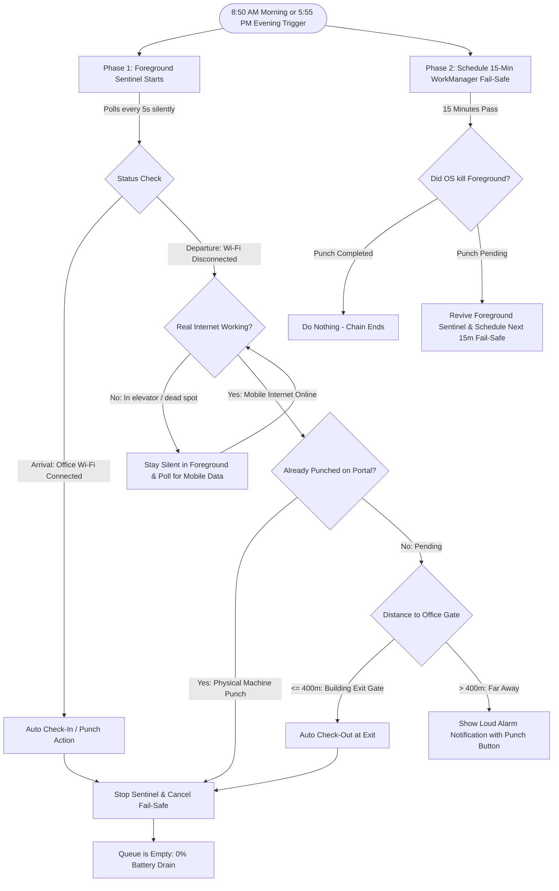

# Office Sentinel & Background Attendance Architecture

> **Notice for Future Agents & Developers:**  
> This document describes the architecture of the **Office Sentinel & Automated Attendance System** in `life_and_study_assistant`. Read this document before making modifications to background workers, notification channels, or attendance services.

---

## 1. System Philosophy & Battery Optimization

Prior to this architecture, the app used a legacy 24/7 periodic WorkManager task running every 15 minutes (96 wakeups per day). This caused unnecessary battery drain during midday and night.

The new architecture adopts the **2-Phase Chained Guardian Model**:
1. **Zero 24/7 Periodic Background Tasks:** Periodic WorkManager is completely removed.
2. **Two Critical Windows per Day:**
   - **Morning Window (8:50 AM – 10:00 AM):** High-precision arrival detection strictly **UNTIL** check-in is complete.
   - **Evening Window (5:45 PM – 10:30 PM):** High-precision departure monitoring strictly **UNTIL** check-out is complete.
3. **Midday & Night Sleep:** Outside these two windows (10:01 AM – 5:44 PM and after 10:30 PM), **zero background tasks and zero foreground services are running**.
4. **Self-Destruct on Punch:** As soon as check-in or check-out is completed (or verified on the server), both the foreground sentinel and the fail-safe watchdog immediately cancel themselves.

---

## 2. Architecture Diagram

---

## 3. Core Components

### 3.1 Foreground Sentinel (`lib/core/services/background/office_sentinel_service.dart`)
- **Class:** `OfficeSentinelTaskHandler` extends `TaskHandler`.
- **Polling Rate:** 5 seconds (`ForegroundTaskEventAction.repeat(5000)`).
- **Silent Ongoing Notification Channel:**
  - `channelId`: `NotificationConstants.sentinelChannelId` (`office_sentinel_silent_channel_v1`).
  - `channelImportance`: `NotificationChannelImportance.LOW`.
  - `priority`: `NotificationPriority.LOW`.
  - `enableVibration`: `false` (Zero vibration).
  - `playSound`: `false` (Zero sound).
  - `onlyAlertOnce`: `true` (Prevents Android from re-alerting or buzzing on status updates).
- **Deduplicated Updates (`_updateForegroundNotification`):**
  Caches `_lastNotifTitle` and `_lastNotifText`. Never calls `FlutterForegroundTask.updateService(...)` unless the title or text has actually changed, preventing Android OS notification manager spam.
- **Throttled Manual Reminders:**
  `showOfficeCheckInReminder` and `showOfficeCheckOutReminder` are rate-limited to at most once every 5 minutes.

### 3.2 Chained One-Off Fail-Safe (`lib/core/services/background/workmanager_service.dart`)
- **Method:** `scheduleSafetyWatchdog({Duration delay = const Duration(minutes: 15)})`.
- **Task Unique Name:** `'sentinel-failsafe-watchdog'`.
- **Existing Work Policy:** `ExistingWorkPolicy.replace`.
- **Cancellation:** `cancelSafetyWatchdog()` removes the task by unique name.
- **Role:** If the OS kills the foreground service (due to extreme low memory) or the user swipes away the app before check-in or check-out is complete, this task fires 15 minutes later:
  - If punch is done: does nothing, chain terminates.
  - If punch is pending: restarts the foreground sentinel and chains the next 15-minute fail-safe.

### 3.3 Exact Native Alarms (`lib/core/services/notification/notification_service.dart`)
- Uses Android `AlarmManager` (`AndroidScheduleMode.exactAllowWhileIdle`) via `flutter_local_notifications`.
- **Morning Watchdogs:** 8:50 AM, 9:00 AM, 9:06 AM, 9:12 AM.
- **Evening Watchdogs:** 5:55 PM, 6:00 PM, 6:05 PM, 6:10 PM, 6:15 PM.
- Reliable even under aggressive OEM battery optimizations and Android Doze Mode.

### 3.4 Notification Action Handlers (`lib/core/services/notification/notification_action_handler.dart`)
When the user taps action buttons from notification trays (`⚡ Punch In Now` or `⚡ Check Out Now`):
1. Submits punch request via `PacklyAttendanceService`.
2. On success, calls `FlutterForegroundTask.stopService()`.
3. Calls `WorkmanagerService.instance.cancelSafetyWatchdog()`.

---

## 4. Key Edge Cases & Business Rules

### 4.1 Mobile Internet Recovery on Wi-Fi Disconnection
When leaving the office building, Wi-Fi drops immediately, but mobile data may take 10–20 seconds to establish an IP connection, or the user may be in an elevator/staircase dead zone:
- The sentinel runs `_hasRealInternet(prefs)` using `InternetAddress.lookup('google.com')` with a 3-second timeout.
- If offline, it updates the notification to:
  `"📶 Wi-Fi বিচ্ছিন্ন - ইন্টারনেটের অপেক্ষা..."`  
  `"রুম/সিঁড়িতে সংযোগ বিচ্ছিন্ন। মোবাইল নেটওয়ার্ক সচল হওয়া মাত্রই চেক-আউট হবে..."`
- It does **not** fail or spam failed HTTP requests.
- As soon as the mobile network is reachable, it verifies server status and immediately performs the check-out.

### 4.2 Distance-Aware Departure Caution
- **Before 6:00 PM (Early Out):** Never auto check-out without asking. Notifies with early departure warning.
- **At or After 6:00 PM:**
  - **$\le 400$m from office:** User is at the building exit gate / door. Safe to auto-punch.
  - **$> 400$m from office:** User moved far away. Does **not** auto-punch blindly; triggers urgent alarm notification with action button `[⚡ এখনই চেক-আউট পাঞ্চ দিন]`.

### 4.3 Off-Days and Holidays
- Suppresses all check-in/check-out automations and reminders on weekly off-days (Thursday & Friday) and official company holidays.
- **Holiday Display with Bengali Weekdays:** `PacklyHoliday.formattedWithWeekday` displays both the date and the day of the week in Bengali (e.g. `২১ Feb (শনিবার)` or `১০-১২ Apr (বৃহস্পতিবার - শনিবার)`).

---

## 5. Verification Checklist for Developers

When modifying this subsystem, verify:
1. `flutter analyze lib/` returns 0 issues.
2. `flutter test test/packly_attendance_service_test.dart test/steadfast_lunch_service_test.dart` passes all tests.
3. Sentinel notification channel (`office_sentinel_silent_channel_v1`) has `enableVibration: false` and `channelImportance: LOW`.
4. Foreground service stops and WorkManager safety watchdog is cancelled immediately upon successful punch.
