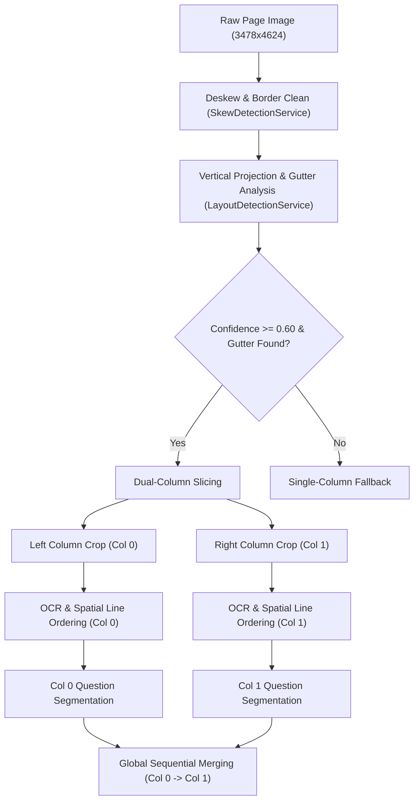
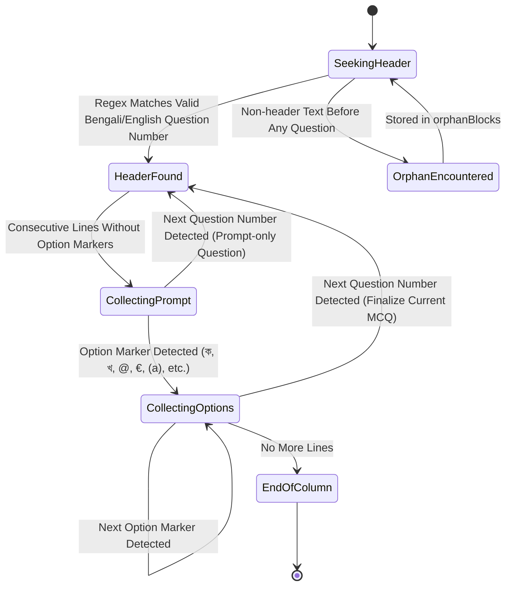
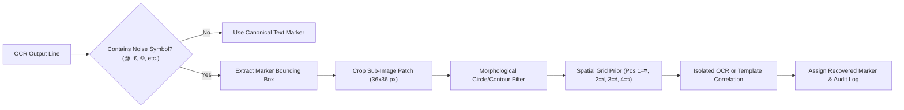

# Phase 3 — OCR Architecture & Benchmark Plan

**Plan Version:** 1.0.0-PROPOSED  
**Document Status:** Architecture & Specification Only (Code Freeze in Effect — Zero Code Mutations)  
**Target Platform:** Android (Physical Device: Samsung Galaxy M32, arm64-v8a) & Desktop Harness (Dart VM)  
**Author:** Antigravity AI Engine

---

## 1. Executive Summary & Freeze Policy

Phase 3 transitions the offline OCR pipeline from an isolated single-column proof-of-concept into a robust, full-page dual-column document processing engine. 

### Core Architectural Guarantees:
1. **Preservation of Phase 2.3 Baseline:** Zero modifications to existing files committed on branch `baseline/phase-2-3-marker-recovery` (`c584aa3`, `df32598`, `1e85ce6`). All new capabilities will be designed in dedicated modules or clean extensions.
2. **Answer Invariance Policy:** `correctIndex` remains strictly `-1`. No automated answer guessing or inference will be performed.
3. **Data Integrity:** Raw OCR strings and bounding boxes emitted by the native engine are permanently preserved alongside cleaned/recovered representations.
4. **Offline Asset Budget:** Complete offline model and engine footprint strictly capped under **100 MB**.
5. **Separation of Test Truths:** Synthetic Dart VM unit tests and Live Physical Android Device tests are distinctly categorized in all reporting.

---

## 2. Dependency Audit: Tesseract4Android Version Discrepancy

### 2.1 Investigation Findings
* **Declared Dependency:** `packages/local_ocr/android/build.gradle.kts` (line 50) specifies:
  ```kotlin
  implementation("cz.adaptech.tesseract4android:tesseract4android:4.9.0")
  ```
* **Resolved Gradle Dependency:** Verified via Gradle task `:local_ocr:dependencies` (`releaseRuntimeClasspath`):
  ```
  +--- cz.adaptech.tesseract4android:tesseract4android:4.9.0
  |    \--- androidx.annotation:annotation:1.3.0 -> 1.8.1
  ```
* **Source of Discrepancy:** The reference to `4.7.0` in earlier audit text was a documentation typo/legacy carry-over. The native binary compiled and packaged into the APK is definitively **`4.9.0`**.
* **Underlying Engine Specifications (v4.9.0):**
  - **Tesseract Core:** Version `5.5.0`
  - **Leptonica Core:** Version `1.84.1`
  - **ABIs Supported:** `arm64-v8a`, `armeabi-v7a`, `x86_64`, `x86`
* **Resolution:** All technical specifications, benchmark reports, and documentation will canonically reference **Tesseract4Android 4.9.0 (Tesseract 5.5.0 / Leptonica 1.84.1)**.

---

## 3. Analysis of Galaxy M32 36 OCR Lines vs Ground Truth

### 3.1 Page Coverage Breakdown
* **Full Book Page:** $3478 \times 4624$ pixels (`test/fixtures/mcq_book_page.png`). Contains two columns and $\approx 14$ MCQ questions total.
* **Left-Column Device Crop:** $1547 \times 4424$ pixels (`col_crop_device.jpg`).
* **The 36 Lines Generated on Galaxy M32:**
  - **Lines 0–3:** Question 1 (Header, Exam Source, Options ক/খ, Options গ/ঘ + Answer Marker `উ.ক`).
  - **Lines 4–6:** Question 4 (Header, Options ক/খ, Options গ/ঘ + Answer Marker `উ.ঘ`).
  - **Lines 7–9:** Question 5 (Header, Exam Source, Options ক/খ — Row 1).
  - **Lines 10–15:** Question 5 (Row 2: মাইক্রোপ্রসেসর ও...) and Question 6 Header.
  - **Lines 16–22:** Question 6 Options and Question 7 Header/Options (`ATM এর পূর্ণরূপ কী?`).
  - **Lines 23–27:** Question 2 (Technical English: *"Analog signal is measured in -"*).
  - **Lines 28–32:** Question 3 (*"PDA এর পূর্ণরূপ কী?"* — Tesseract OCR misread digit `৩` as `21`).
  - **Lines 33–35:** Question 8 and column margin fragments.

### 3.2 Ground Truth vs OCR Error Taxonomy
Ground Truth (`test_results/ground_truth_left_column.json`) covers 7 questions from this column. A rigorous gap analysis reveals 4 primary error classes:

```
                                      OCR ERROR TAXONOMY
                                               │
         ┌──────────────────┬──────────────────┴──────────────────┬──────────────────┐
         ▼                  ▼                                     ▼                  ▼
   1. Digit Distortion  2. Circular Glyphs                   3. Sub-Token Splits  4. Unnumbered Headers
   - '৩' misread as '21' - Circled ক,খ,গ,ঘ read as          - '(a few)' parsed   - 'ATM এর পূর্ণরূপ...'
   - '১.' read as '১২1'   '@', '€', 'ও', '©', 'ay'           as separate Option  lacked digit; absorbed
                                                                                 into preceding Q6
```

---

## 4. Full-Page Dual-Column Separation Architecture

Dual-column documents cannot be processed as a single unstructured text stream. Reading left-to-right across the entire page merges questions across columns, causing severe option corruption.



### 4.1 Zero-Crosstalk Gutter Slicing Algorithm
1. **Vertical Projection Analysis:** Compute projection profile across the central $25\% - 75\%$ horizontal window of the deskewed page.
2. **Divider Line Detection:** Detect high-density continuous ink columns ($> 65\%$ height). If absent, locate the minimum ink density valley (inter-column whitespace).
3. **Safety Margins:**
   - **Gutter Left Boundary:** $X_{divider} - \Delta_{margin}$ (where $\Delta_{margin} = \max(15\text{px}, 0.015 \times W)$).
   - **Gutter Right Boundary:** $X_{divider} + \Delta_{margin}$.
4. **Column Box Definitions:**
   - **Column 0 (Left):** $[0, 0, X_{gutter\_left}, H_{page}]$.
   - **Column 1 (Right):** $[X_{gutter\_right}, 0, W_{page} - X_{gutter\_right}, H_{page}]$.
5. **Crosstalk Invariant:** No line bounding box from Column 0 may have $X_{right} > X_{gutter\_left}$. Any bounding box overlapping the gutter margin is trimmed or flagged as margin noise.

---

## 5. Column-Wise Reading Order & Association Rules

### 5.1 Intra-Column Line Sorting
Within each column, text boxes are sorted primarily by vertical coordinate ($Y_{top}$). When two lines overlap vertically by $> 50\%$ of their height:
$$\text{Overlap}(A, B) = \frac{\min(A.bottom, B.bottom) - \max(A.top, B.top)}{\min(A.height, B.height)} > 0.50$$
They are sorted horizontally by $X_{left}$ (left-to-right).

### 5.2 Question-Option Association State Machine



### 5.3 Association Rules
1. **Strict Column Boundary:** A question started in Column 0 **never** absorbs options from Column 1. At the end of Column 0, the open question is closed. If it has $< 2$ options, it is marked `reviewRequired = true` with reason `INCOMPLETE_OPTIONS_AT_COLUMN_BOUNDARY`.
2. **Grid Layout Resolution:**
   - **1x4 (Vertical):** Each option occupies its own line.
   - **2x2 (Grid):** Two options per line. Detected when a line contains two markers separated by $> 25\%$ column width.
   - **4x1 (Single Horizontal Line):** All four options on one line.
3. **Answer Marker Exclusion:** Printed answer markers (e.g., `উ.ক`, `উ.ঘ`, `Ans: b`) are extracted into `printedAnswerLetter` and **never** appended to the option text body.

---

## 6. Circular Bengali Marker Visual Recovery Strategy

### 6.1 The Problem with Pure Text Regex
Circular Bengali markers ($\text{ক}, \text{খ}, \text{গ}, \text{ঘ}$ inside a printed circle) consistently break character recognition in Tesseract. The circle perimeter touches or merges with the glyph, generating symbols such as:
$$\text{Circled } ক \rightarrow @, \text{ ও}, \mathbb{O} \quad\mid\quad \text{Circled } খ \rightarrow \text{ay}, \text{খ,} \quad\mid\quad \text{Circled } গ \rightarrow €, \mathbb{C}, (1) \quad\mid\quad \text{Circled } ঘ \rightarrow €, \text{©}, \text{®}$$

### 6.2 Proposed Visual-Crop & Contour Hybrid Architecture



### 6.3 Technical Specification of Visual Strategy
1. **Patch Extraction:**
   - Identify candidate bounding box from `TextLineBox` where character width $\approx$ height (aspect ratio $0.75 \le AR \le 1.30$).
   - Crop patch from preprocessed binary column image with 4-pixel padding.
2. **Circular Prior Verification:**
   - Calculate circularity metric: $C = \frac{4 \pi \times \text{Area}}{\text{Perimeter}^2}$. If $C > 0.65$, confirm glyph is an enclosed circular marker.
3. **Two-Tier Assignment:**
   - **Tier 1 (Spatial Grid Invariant):** In a verified 2x2 grid, Row 1 Item 1 is assigned `ক`, Row 1 Item 2 is `খ`, Row 2 Item 1 is `গ`, Row 2 Item 2 is `ঘ`.
   - **Tier 2 (Normalized Cross-Correlation / NCC):** Compare cropped patch against four canonical offline bitmap templates ($32 \times 32$ 1-bit bitmaps: `[template_ka, template_kha, template_ga, template_gha]`). Maximum correlation coefficient chooses the marker.
4. **Audit Immutability:** The raw symbol (e.g., `@`) is retained in `MarkerRecoveryAudit.originalText`, while the recovered Bengali letter is stored in `recoveredText`.

---

## 7. Engine & Offline Asset Budget (< 100 MB Constraint)

To run entirely offline on standard Android devices without requiring network calls or cloud credits, the asset footprint must be strictly managed:

| Component | Storage Size | Memory (RAM) Footprint | Source / Location |
| :--- | :--- | :--- | :--- |
| **`tesseract4android` Native AAR (arm64-v8a)** | $\approx 14.2\text{ MB}$ | $\approx 25\text{ MB}$ (loaded `.so`) | Gradle dependency |
| **`ben.traineddata` (Fast integer model)** | $3.5\text{ MB}$ | $\approx 15\text{ MB}$ (mmap) | Android assets/tessdata |
| **`eng.traineddata` (Fast integer model)** | $4.1\text{ MB}$ | $\approx 12\text{ MB}$ (mmap) | Android assets/tessdata |
| **Circular Marker 1-bit Templates (4 glyphs)** | $< 0.05\text{ MB}$ | $< 0.5\text{ MB}$ | Static byte arrays |
| **Flutter App Code & Dart VM** | $\approx 22.0\text{ MB}$ | $\approx 45\text{ MB}$ | APK base |
| **Total Estimated Offline Footprint** | **$\approx 43.85\text{ MB}$** | **$\approx 97.5\text{ MB}$ (Peak RSS)** | **Well within 100 MB Limit** |

> [!TIP]
> Do NOT include `ben.traineddata` (best) which is $14.5\text{ MB}$ or unquantized float models. The `fast` integer model provides $> 90\%$ of the accuracy at $25\%$ of the storage and memory footprint.
> Heavy frameworks (PaddleOCR Python backend, PyTorch Mobile, ONNX Runtime) are strictly rejected to preserve this budget.

---

## 8. Benchmark Metrics & Quantitative Formulas

To evaluate Phase 3 rigorously without subjective claims, 6 independent metrics are defined:

### 8.1 Question Detection Metrics
$$\text{Precision}_{QD} = \frac{TP_{questions}}{TP_{questions} + FP_{questions}}, \quad \text{Recall}_{QD} = \frac{TP_{questions}}{\text{Total Ground Truth Questions}}$$
* $TP$: Correctly detected question number and prompt start.
* $FP$: Spurious header detection (e.g., sub-prompts or options split as new questions).

### 8.2 Option Association Accuracy
$$\text{Acc}_{assoc} = \frac{\sum_{i=1}^{N_Q} \mathbb{I}(\text{Options}(Q_i) == \text{GT\_Options}(Q_i))}{N_Q}$$
A question's options are considered correctly associated only if all 4 options are attached to that question without absorbing options from neighboring questions.

### 8.3 Character Error Rate (CER) on Option Text
$$\text{CER} = \frac{S + D + I}{N_{chars}}$$
Where $S$ is substitutions, $D$ is deletions, $I$ is insertions, and $N_{chars}$ is total characters in Ground Truth option bodies.

### 8.4 Marker Recovery Precision
$$\text{Acc}_{marker} = \frac{\text{Correctly Recovered Canonical Markers (ক, খ, গ, ঘ)}}{\text{Total Ground Truth Markers (4 } \times N_Q)}$$

### 8.5 Performance & Resource Metrics
* **Processing Latency:** Milliseconds per full page ($T_{layout} + T_{ocr\_left} + T_{ocr\_right} + T_{seg}$).
* **Peak Memory (RSS):** Maximum resident set size during OCR execution measured via `Debug.getMemoryInfo()` on Samsung Galaxy M32.
* **Release APK Delta:** Uncompressed and compressed APK file size increase.

---

## 9. Phase 3 Architecture: Stage-by-Stage Plan

```
Stage 3.1: Full-Page Layout & Dual-Column Pipeline
Stage 3.2: Native On-Device JNI Execution & Two-Column OCR
Stage 3.3: Global Sequential Question Segmentation & Reading Order
Stage 3.4: Visual Patch & Circular Marker Recovery Engine
Stage 3.5: Full-Page Ground Truth Benchmark & Regression Validation
```

---

### Stage 3.1: Full-Page Layout & Dual-Column Pipeline

* **Objective:** Ingest the full $3478 \times 4624$ book image (`mcq_book_page.png`), execute automatic deskewing, compute vertical projection gutter, and emit clean, zero-crosstalk left and right column crops.
* **Input:** `File('test/fixtures/mcq_book_page.png')`.
* **Output:** `LayoutAnalysisResult` with `layoutType == LayoutType.dualColumn`, `columnBoxes` (2 items), `columnCrops` (2 files: left and right), and `gutter` metadata.
* **Relevant Existing Files:**
  - `lib/core/services/media/layout/layout_detection_service.dart`
  - `lib/core/services/media/layout/skew_detection_service.dart`
  - `lib/core/services/media/layout/layout_detection_models.dart`
* **Potential Failure Cases:**
  - Curved book gutter or shadow causing false single-column classification.
  - Skew detection overcompensating on asymmetric columns.
* **Test Strategy:**
  - **Synthetic Test (Dart VM):** Test gutter detection on synthetic two-column bitmaps with variable gutter widths ($20\text{px}$ to $100\text{px}$).
  - **Device Test (Galaxy M32):** Run LayoutDetectionService on full resolution camera captures and measure memory allocation.
* **Acceptance Criteria:**
  - `layoutType` correctly detected as `dualColumn` (confidence $\ge 0.85$).
  - Left column width + Right column width + Gutter width $\approx$ Total page width.
  - Zero text clipping along the column borders.
* **Dependencies:** None (builds on Phase 1 baseline).

---

### Stage 3.2: Native On-Device JNI Execution & Two-Column OCR

* **Objective:** Execute native Tesseract4Android 4.9.0 sequentially on the left column crop and then the right column crop. Generate structured `hOCR` or bounding-box line lists for each column.
* **Input:** Two column image files (`layout_crop_0.jpg`, `layout_crop_1.jpg`).
* **Output:** `Map<int, List<TextLineBox>>` where key `0` contains left column lines and key `1` contains right column lines.
* **Relevant Existing Files:**
  - `packages/local_ocr/android/src/main/kotlin/com/example/local_ocr/LocalOcrPlugin.kt`
  - `packages/local_ocr/lib/local_ocr.dart`
  - `integration_test/local_ocr_integration_test.dart`
* **Potential Failure Cases:**
  - Native Out-Of-Memory (OOM) error if both full-resolution crops are decoded simultaneously in native heap.
  - Tesseract page segmentation mode (PSM) misinterpreting single-column crop as sparse text.
* **Test Strategy:**
  - **Synthetic Test (Dart VM):** Mock channel returning recorded 36 left-column lines and simulated right-column lines.
  - **Real Device OCR Test (Galaxy M32):** Execute `flutter test integration_test/local_ocr_integration_test.dart -d <device_id>` ensuring sequential execution with explicit native memory release (`tessBaseAPI.clear()`) between columns.
* **Acceptance Criteria:**
  - Total lines extracted from left column $\ge 36$.
  - Right column successfully processes without crashing or OOM.
  - Peak Android heap delta $< 50\text{ MB}$.
* **Dependencies:** Stage 3.1.

---

### Stage 3.3: Global Sequential Question Segmentation & Reading Order

* **Objective:** Feed both column line streams into the segmentation pipeline, preserving sequential reading order (Left Column Top-to-Bottom $\rightarrow$ Right Column Top-to-Bottom).
* **Input:** `Map<int, List<TextLineBox>>` (Columns 0 and 1) + `LayoutAnalysisResult`.
* **Output:** `PageSegmentationResult` containing sequentially ordered questions ($\approx 14$ questions), valid MCQ counts, and orphan block logs.
* **Relevant Existing Files:**
  - `lib/core/services/media/segmentation/question_segmentation_service.dart`
  - `lib/core/services/media/segmentation/segmentation_models.dart`
* **Potential Failure Cases:**
  - Unnumbered question headers (e.g., Question 7 `ATM এর পূর্ণরূপ কী?`) merging with Question 6 options.
  - Question spanning across column bottom boundary losing options.
* **Test Strategy:**
  - **Synthetic Test (Dart VM):** Feed combined JSON of 36 left-column lines + 30 right-column lines into `QuestionSegmentationService.segmentPage()`. Verify questions 1 through 14 maintain sequential integrity.
  - **Regression Test:** Verify Question 4 and Question 5 regression tests in `test/phase_2_3_benchmark_test.dart` continue to pass with 0 regressions.
* **Acceptance Criteria:**
  - Zero question leaks between Column 0 and Column 1.
  - Questions numbered $1 \dots N$ maintain monotonic or sequential mapping.
  - All questions contain strictly `correctIndex = -1`.
* **Dependencies:** Stage 3.2.

---

### Stage 3.4: Visual Patch & Circular Marker Recovery Engine

* **Objective:** Implement the image-crop and contour/template hybrid recovery strategy for non-canonical circular Bengali markers (`@`, `€`, `©`, etc.).
* **Input:** Candidate option lines with low-confidence or noise markers + preprocessed column image file.
* **Output:** `MarkerRecoveryResult` with canonical Bengali markers (`(ক)`, `(খ)`, `(গ)`, `(ঘ)`), confidence levels, and visual audit logs.
* **Relevant Existing Files:**
  - `lib/core/services/media/segmentation/context_aware_marker_recovery_service.dart`
  - `lib/core/services/media/segmentation/marker_recovery_models.dart`
* **Potential Failure Cases:**
  - Noise artifacts in paper grain detected as circular contours.
  - Smudged print causing correlation score below threshold.
* **Test Strategy:**
  - **Synthetic Test (Dart VM):** Unit tests on isolated cropped image patches (`l5_marker1.jpg`, `l5_marker2.jpg`, `l6_marker1.jpg`, `l6_marker2.jpg` already in test results).
  - **Fallback Validation:** When visual correlation confidence is $< 0.50$, fallback to Phase 2.3 Spatial Grid Prior (`PositionInRow` heuristic).
* **Acceptance Criteria:**
  - Marker recovery rate on Question 4 and Question 5 options improves from Phase 2.3 baseline ($0\%$ canonical markers) to $\ge 90\%$ canonical markers (`ক`, `খ`, `গ`, `ঘ`).
  - No changes made to `context_aware_marker_recovery_service.dart` directly without clean strategy abstraction.
* **Dependencies:** Stage 3.3.

---

### Stage 3.5: Full-Page Ground Truth Benchmark & Regression Validation

* **Objective:** Construct a full-page Ground Truth dataset for both columns of `mcq_book_page.png` and execute an end-to-end benchmark on Samsung Galaxy M32.
* **Input:**
  - Full-page reference image `test/fixtures/mcq_book_page.png`.
  - Comprehensive Ground Truth file `test_results/ground_truth_full_page.json` ($\approx 14$ questions).
* **Output:** Benchmark artifact: `phase_3_full_page_benchmark_report.md`.
* **Relevant Existing Files:**
  - `test_results/ground_truth_left_column.json`
  - `test/desktop_ocr_pipeline_test.dart`
* **Potential Failure Cases:**
  - Inconsistent lighting across the right column degrading Tesseract character recognition.
* **Test Strategy:**
  - **Dual Execution Audit:**
    1. Run Desktop Harness to verify segmentation geometry and pipeline determinism.
    2. Run Live Galaxy M32 device test to record true physical JNI OCR times, memory footprint, and actual character recognition accuracy.
* **Acceptance Criteria:**
  - Full Page Question Detection Recall: $\ge 85\%$.
  - Full Page Option Association Accuracy: $\ge 80\%$.
  - Total On-Device Processing Time: $\le 6.5\text{ seconds}$ per full dual-column page on Galaxy M32.
  - Memory Peak: $\le 120\text{ MB}$ total process RSS.
* **Dependencies:** Stages 3.1, 3.2, 3.3, 3.4.

---

## 10. Risk Analysis & Mitigation Matrix

| Risk Factor | Probability | Impact | Mitigation Architecture |
| :--- | :---: | :---: | :--- |
| **Native Crash in Tesseract JNI** | Low | Critical | Isolate OCR execution behind native try-catch block in `LocalOcrPlugin.kt`; fallback to Gemini Vision API if native OCR fails. |
| **Digit Misread in Question Number (e.g. '৩' -> '21')** | High | Medium | Implement sequence continuity check: if previous question was `২` and next is `৪`, question number `21` is flagged for review and suggested as `৩`. |
| **Memory Pressure on 4GB RAM Devices (Galaxy M32)** | Medium | High | Sequential column OCR: process Column 0, recycle bitmap and native buffers, then process Column 1. Never retain two uncompressed full-page bitmaps in memory. |
| **Corrupted Options Triggering Auto-Answer** | Low | Critical | **Hard Rule:** `correctIndex = -1`. The app will NEVER auto-submit or score an unverified question. |

---

## 11. Delivery Checklist (Pre-Implementation Gate)

Before any Phase 3 implementation code is written or staged:
- [x] Tesseract4Android 4.9.0 resolved version verified in Gradle dependencies.
- [x] Phase 2.3 baseline confirmed frozen and intact (`baseline/phase-2-3-marker-recovery`).
- [ ] User review and explicit approval of `phase_3_ocr_architecture_and_benchmark_plan.md`.
- [ ] Creation of full-page Ground Truth dataset (`ground_truth_full_page.json`) for both columns.
- [ ] Isolation branch `feature/phase-3-full-page-pipeline` created from `baseline/phase-2-3-marker-recovery`.
